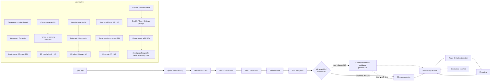

# User Journey

Image: `../diagrams/user_journey_flowchart.png`. The Mermaid version below
renders on GitHub. Solid arrows are transitions the app performs today;
dashed arrows are planned (Phase 2 roadmap).

## Walkthrough

1. **Open app → splash → onboarding** 🟢 — a 2 s splash, then three
   onboarding pages (currently shown on every launch).
2. **Home dashboard** 🟢 — map, live position, search card. Location
   permission is requested only when you tap locate.
3. **Search → select** 🟢🔵 — Google Places results with your distance;
   results are never stale (M0). Selecting needs a GPS fix to continue to a
   route.
4. **Preview route** 🟢 — driving route, time and distance; walking arrives
   with M3.
5. **Start navigation** 🟢 — a turn-by-turn session starts.
6. **AR or map?** 🟠 — after M5, the app checks ARCore support, camera and
   heading, and offers camera-based guidance. **Today the answer is always
   "map"**: AR navigation is not built.
7. **Real-time guidance** 🟢🔵 — each GPS fix updates the next instruction
   and remaining distance/time (corrected in M0).
8. **Deviation → rerouting** 🟢🔵 — over 40 m off the route, or a sustained
   wrong direction, triggers a new route from your current position. M0
   guarantees the reroute respects Stop, Pause and new sessions.
9. **Destination reached** 🟢 — within 25 m: "You've arrived".

## Alternative paths

| Path | Today | After Phase 2 |
|---|---|---|
| Camera permission denied | Plain message + Try again | Plus "Continue on 2D map" from AR (M5) |
| Camera unavailable | Honest message; app keeps working | AR session falls back to 2D automatically (M5) |
| Heading unavailable | Detected; shown in Diagnostics | AR offers 2D map with the reason (M5) |
| User switches to 2D map | Not applicable (no AR yet) | Map ⇄ AR buttons, same session (M5) |
| GPS unavailable / inaccurate | Enable / Open Settings prompts; weak-signal flag; routes need a fix | Short gaps bridged by step-based dead reckoning with growing uncertainty (M4) |
